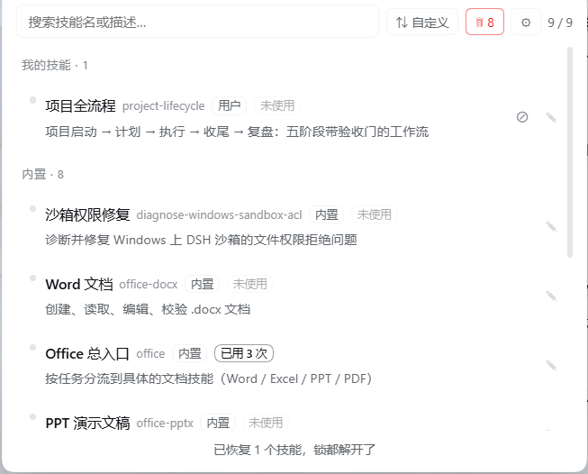

<p align="center">
  
</p>

# dsh-skill-quickpick

[English](README.en.md) | [中文](README.md)

[](https://www.npmjs.com/package/@deepseek-ai/dsh)
[](LICENSE)

[](#release-status)

A **skill quick-pick panel** for DeepSeek Harness: a button in the composer toolbar opens a panel of the skills available in the current session — grouped by source, Chinese names and descriptions included — and one click inserts `/skill-name ` **into the draft. It never sends anything.**

Once you have thirty skills, you stop remembering their English names. Search in Chinese instead.



> Real screenshot (light theme): grouped by source, Chinese + English names side by side, usage counters, per-row disable/edit actions.

## What you get

- **Chinese names and descriptions** — a built-in dictionary, model-based auto-translation, and your own manual overrides, in that priority order (yours always wins). Translation sends only the skill's name and description, never its body.
- **Insert without breaking flow** — one click drops `/skill-name ` at the cursor, **keeps the draft you already typed**, and returns focus to the composer so you can keep writing and press Enter yourself.
- **Stays usable at scale** — grouping by source (My skills / Project skills / Built-in / Other), drag-drop ordering within a group, bilingual search, and rows already in the draft are dimmed.
- **Manage skills like assets** — disable/enable (hidden from the model, still usable by you), uninstall to a trash bin with timed cleanup, and usage counters (model-loaded vs. manually invoked) that expose dead weight.

## What it does

| Capability | Notes | Default |
|---|---|---|
| List skills | From the host's `skills.list`, same source as the composer's `/` menu | On |
| **Group by source** | My skills / Project skills / Built-in / Other | On |
| Chinese names | Built-in dictionary + **auto-translation** + **your overrides** | Behind toggle |
| One-click insert | `insertText` at cursor (never overwrites); falls back to `setDraft` append | On |
| Duplicate guard | Rows already present in the draft are dimmed | On |
| Focus return | Focus goes back to the composer after insertion | On |
| Bilingual search | Matches Chinese name, Chinese description, English name, English text | On |
| **Edit Chinese info** | Name / description / personal note per skill | On |
| **Drag-drop ordering** | Reorder rows; **only within a group**, never across | On |
| **Disable / enable** | Remove a skill from the model's catalog, or add it back | **Off** |
| **Usage stats** | Model-loaded + manually-invoked counters; unused skills labelled | **Off** |
| **Sort switch** | Custom (drag) / by usage / by name, three-state cycle | On |
| **Uninstall** | Move the whole skill directory to trash, restorable | **Off** |
| **Trash with timed purge** | Uninstalled skills auto-purge after a retention period; **no manual permanent delete** | **Off** |

**What it does not do**: auto-send, call `submit()`, or lock the model to a single skill.

## Feature toggles (⚙)

The panel's gear button switches on risky capabilities one by one. **All start off.** Out of the box the plugin only lists skills, groups them, searches, inserts into the draft, edits Chinese metadata, and reorders — **it does not call models, read session logs, or move skill directories** (editing metadata and drag-ordering write two JSON files owned by the plugin under `dsh-home`, never touching skill files).

| Toggle | Default | When enabled | When off |
|---|---|---|---|
| **Disable / enable skills** | Off | Rewrites `disable-model-invocation` in `SKILL.md` | The ⊘ button is not rendered; **but ↺ on already-disabled rows always works** and "Restore all" stays available |
| **Uninstall / trash** | Off | Moves skill directories; **permanently deletes** when retention expires | Trash entry disappears, `/trash` route returns 403, cleanup timer does nothing |
| **Auto-translate descriptions** | Off | Sends skill **names and descriptions** to a model (never the body) | Only cached translations and your manual Chinese are shown |
| **Usage stats** | Off | Reads and decompresses local session logs; counts only, stores nothing | No session files read, no usage counters shown |

**Why "enable" is not gated by its toggle**: enabling is an *unlock* — it lowers risk instead of raising it. If unlocking were also gated, turning the toggle off would leave already-locked skills permanently locked, which is worse.

**Two things to know**:

1. **Toggles are not the security boundary.** The real boundary is the host-side path validation (see [Security](#security)), and a disabled toggle makes the host **return 403** rather than merely hiding the button. Defaults are about "don't take on risk you didn't agree to", not about defence against attackers.
2. **Toggles take effect immediately, and re-enabling recovers immediately** — the trash cleanup timer and stats scanner always exist and read the toggle on each run, so **no restart is needed**.

## Drag-drop ordering

- **Only within the same group** — cross-group drops are rejected (groups are derived from paths; moving across would falsify the "source" label).
- Order is saved to `skill-quickpick-order.json`.
- **Drag is disabled while a search filter is active** — ordering is computed from the full list, so dragging in a filtered view would number only the visible rows and silently scramble everything else.
- The sort mode cycles custom / usage / name and is remembered (localStorage).

## Chinese translations, in priority order

```
your manual edit  >  built-in dictionary  >  auto-translation  >  English original
```

Three independent layers, three separate files — deleting one never loses another:

| Layer | File | Written by | Used when |
|---|---|---|---|
| Your edit | `dsh-home/skill-quickpick-user.json` | you (in the panel) | always highest |
| Built-in dictionary | `ZH` constant in code | maintained by hand | before machine translation; keeps curated wording |
| Auto-translation | `dsh-home/skill-quickpick-zh.json` | generated | when the first two miss |

### How auto-translation works

Skill descriptions live in `SKILL.md` frontmatter. The browser half cannot read files or call models, so translation happens on the **host half**:

```
client finds skills without Chinese
   ↓ POST /skill-quickpick/translate
host checks cache → translates misses via fallback chain → validates → caches → returns
   ↓ cache hit
returns immediately (no model call, translated: 0)
```

**Each skill is translated once**, then always served from cache. The fallback chain goes `bailian/glm-5.3-prime` → `bailian/kimi/...` → `bailian/stepfun/...` → `deepseek-account/deepseek-flash`, switching on errors, non-JSON output, or validation failures. Validation is rule-based (must contain CJK, name ≤ 20 chars, description ≤ 100 chars, description must differ from the source, name must match, technical terms like Word/Excel/PPT must survive). There is deliberately no second-model review — it would double the cost for errors the rules already catch. Failures are not cached, so the next attempt retries.

## Disable / enable

Disabling adds one line to the skill's frontmatter:

```yaml
disable-model-invocation: true
```

| | After disabling |
|---|---|
| Model can discover and call it | ❌ no (it leaves the model catalog) |
| You still see it in the panel | ✅ yes |
| You can still invoke it manually with `/name` | ✅ yes |
| Content already loaded into context | unaffected |

### Which skills can be disabled

| Source | Path | Disable? |
|---|---|---|
| User skills | `<DSH_HOME>/skills/` | ✅ writable local file |
| User agents skills | `<agentsHome>/skills/` (default `~/.agents/skills`) | ✅ |
| **Project skills** | `<projectRoot>/.dsh/skills/` or `<projectRoot>/.agents/skills/` | ✅ |
| **Bundled skills** | packed inside `app.asar` (read-only) | ❌ |
| Custom directories (`customSkillDirs`) | DSH config | ❌ see limitations |
| Runtime-registered skills | in-memory | ❌ no file |

> The panel decides writability by "does it have a `path`?" — `skills.list` only returns a path for local file skills. The "Built-in (read-only)" label really means "no writable local file".

### How project skills are recognised

The project root must **not** come from the HTTP request body — that would hand the permission boundary to the caller. Instead the host:

```
reads dsh-home/sessions/<workspace>/<session>/session.v4.jsonl.zstd
  ↓ decompress only the first frame, take `cwd` from the header (written by DSH itself)
walks up from cwd to the nearest `.git` ancestor = project root (same rule as DSH's findProjectRoot)
  ↓ cached for 60 seconds
<projectRoot>/.dsh/skills and <projectRoot>/.agents/skills enter the trusted roots
```

So a project's skills are manageable **only if a DSH session has recorded that project's cwd**. The plugin never guesses paths for projects it has not seen.

### Safety measures when disabling

Before every write: back up `SKILL.md` to `skill-quickpick-backups/<name>-<date>.md`; touch only the frontmatter, byte-for-byte keeping the body; preserve the original line endings; refuse files without frontmatter; record to `skill-quickpick-disabled.json`.

**Unlocking never breaks**: the enable direction bypasses the trusted-root check, so a lock stays openable even if the project was deleted or the session record was cleaned. That exception may only delete the marker line — never create or move files.

### Restore all (do this before disabling or removing the plugin)

While any disabled record exists, a **`↺ N`** button appears next to the search box. One click restores everything, verifies each file, and clears the records.

**Why manual**: once the plugin is disabled or uninstalled it no longer runs, so no code can unlock for you. The restore action can only happen while the plugin is alive.

## Usage stats

Each row carries counters: model-loaded (the model called the `skill` tool itself) and manual (you typed `/name`). Both zero = "unused".

**Zero token cost** — no model calls; it reads existing session logs (`dsh-home/sessions/**/session.v4.jsonl.zstd`), splits multi-frame zstd, parses JSONL, and counts `tool/call` events for `skill` plus `/name` tokens in real user messages. System-injected text (skill catalog reminders, `skill_content` bodies) is excluded so a single invocation is not counted twice. The count starts at the day the stats feature was first enabled.

The backend scans once 5 seconds after start, then every 5 minutes; the panel's GET endpoint is read-only and only returns the cached result.

## Uninstall and trash

Uninstalling moves the whole skill directory to `dsh-home/skill-quickpick-trash/<timestamp>-<name>/` after a 4-digit numeric confirmation, and records it in an index. The model stops seeing it; the files are still on disk.

**Why there is no manual permanent delete**: the trash *is* the cooling-off period. Allowing "uninstall → empty trash" would defeat the safety net in two clicks. Items purge automatically when retention expires (default 7 days, adjustable 1–360). **Changing the retention period resets the countdown** for every item, so shortening it never instantly deletes anything.

Restoring moves the directory back; restoring is refused if the original location now contains a same-named directory.

## Install

**From the plugin market (recommended)**: open **Settings → Plugins** in DSH Desktop, search `dsh-skill-quickpick`, install.

**Command line** (plain `dsh web`): add the package to your profile, then restart:

```sh
dsh plugin --profile <your-profile> add dsh-skill-quickpick
```

**Fully quit and reopen the client after installing** (host-side changes only load on restart).

## Uninstall

Prefer the uninstall script over deleting the directory by hand:

```powershell
# dry run — shows what it would do
node uninstall-skill-quickpick.mjs --check

# actually uninstall
node uninstall-skill-quickpick.mjs
```

It restores every disabled skill first (aborting if any restore fails, so you can still rescue from the panel), then removes the dependency and bundle registrations, deletes the plugin directory, and keeps your data files unless `--purge-data` is given.

For a plugin that is already gone, `restore-skill-locks.mjs` is the standalone rescue channel — it does not need the plugin installed and works on every `SKILL.md` recorded in `disabled.json`.

## Security

**In one line**: every write is confined to the local skill roots DSH itself scans, all risky features default to off, and the plugin never makes network requests on its own.

### Path boundary

The server never trusts a path from a request body. Every write goes through one validation chain:

| Gate | Rejects |
|---|---|
| ① Shape | non-local absolute paths (UNC `\\server\share`, `\\?\` device prefixes, relative paths) |
| ② Read-only zones | skills packed in `app.asar`, `node_modules/@deepseek-ai/` |
| ③ Filename | basename is not `SKILL.md` (case-insensitive) |
| ④ Real path | `realpath` resolves symlinks/junctions; the target must still be `SKILL.md` |
| ⑤ Hard links | `nlink > 1` is rejected (prevents hard-linking an external file into a skill and editing through it) |
| ⑥ Trusted root | the skill directory's parent must be in the allowlist |

The allowlist mirrors DSH's own filesystem skill provider:

| rank | source | path |
|---|---|---|
| 100 | project skills | `<projectRoot>/.dsh/skills` |
| 200 | project agents skills | `<projectRoot>/.agents/skills` |
| 400 | user skills | `<DSH_HOME>/skills` |
| 500 | user agents skills | `<agentsHome>/skills` (default `~/.agents/skills`) |

- Project roots come from disk (session headers), never from requests.
- If `DSH_HOME` is unset, **no root is trusted** (fail-safe).
- `customSkillDirs` is deliberately not trusted: the plugin cannot read DSH's config object, and guessing a path is not a permission model.

### Data on disk

Everything lives under `dsh-home`; the plugin writes nowhere else. Translation cache, your manual overrides, sort order, toggles, disabled records, backups, trash index, stats cache — all listed in the README's file table.

### Network and data leaving the machine

- The plugin makes **no network requests of its own**; model calls go through the host's configured provider chain.
- **Only auto-translation sends anything out**: skill name + description (frontmatter fields only, never the body), and the UI says so before you enable it.
- Usage stats read local session logs, count, and discard content — nothing is stored or sent.

### Read-only GETs and server-side 403s

Panel GET endpoints are strictly read-only (`/stats` returns cache only, `/trash` never deletes). When a toggle is off the host answers **403** itself — it does not merely hide buttons. Settings/order endpoints reject empty bodies, so an empty POST cannot silently turn everything off or erase the ordering.

### Trash and clock protections

Permanent deletion happens only in the background timer, and every path must pass `isInsideTrash` (realpath check) first. If the system clock jumps backwards or forward by more than the retention period, the whole cleanup round is skipped — better a late deletion than a wrong one.

## Known limitations

- **Disabling the plugin does not auto-restore locks** — DSH's disable action never runs plugin code. The panel shows a warning, the plugin logs it on reload, but the real safeguard is pressing "Restore all" first.
- **The trash cannot be emptied manually** — by design; retention handles it.
- **Trash cleanup runs on a timer**, not when you open the panel; GET `/trash` is read-only.
- **Clock anomalies skip cleanup** rather than risk wrong deletions.
- **Project skills require the project to appear in a session record** — the root is derived from session `cwd`. Projects never opened in DSH, or whose session records were cleaned, show their skills read-only.
- **`customSkillDirs` skills are view-only** for the same reason.
- **Flat skill files (`<root>/<name>.md`) cannot be disabled or uninstalled** — writes support only the directory form `<root>/<name>/SKILL.md`; flat skills are listed and insertable.
- **Stats have a disk-flush delay** — the newest message may appear one scan later.
- **Stats need Node's zstd** — available in current Electron; if removed, stats degrade to unavailable while the rest keeps working.
- **Grouping is heuristic** — `skills/list` has no `provider` field, so grouping is inferred from `path`; empty paths are "Built-in (read-only)".
- **Translation depends on model quota** — if all fallback routes fail, new skills stay English (still usable).
- **Semantic translation quality is not auto-reviewed** — rule validation only.
- **Bundled skills can never be disabled/uninstalled** — that is the host's read-only packaging.
- **Sort mode lives in localStorage** — a new Web GUI port is a new origin, so it resets (drag order is unaffected; it lives in `dsh-home`).

## Development

```powershell
node test-isolated.mjs
```

**62 tests, all passing.** They run entirely in a system temporary directory and never touch a real `dsh-home`: path traversal/UNC/hard-link boundaries, project-root derivation from session headers, the unlock exception, trash retention and clock jumps, HTTP routing (405/400/403/`available:false`, empty-body rejection), and an end-to-end disable→restore flow.

Notable implementation notes for contributors:

```js
// insertion must capture the anchor in the same turn; fall back to append
inserted = actions.insertText('/name ', actions.captureInsertion()) === true

// read the draft from useInput — props.input.draft is always undefined
const inputState = useInput((s) => s)

// return focus after inserting
document.querySelector('[data-composer-card] [contenteditable="true"]')?.focus()

// project roots: first zstd frame of session.v4.jsonl.zstd → header.cwd → nearest .git
// only decompress the first frame, never the whole file

// the single permission entry point: resolveSkillFile(path, { allowUnlock })
// allowUnlock is enable/restore only — it may delete the marker line, nothing else
```

## Release status

v0.1.0. Submitted to [awesome-dsh-plugin](https://github.com/awesome-dsh-plugin/awesome-dsh-plugin) for listing (under review).

Not published to npm — this does not affect listing or installability; the plugin installs from this repository.

## License

[MIT](LICENSE)
