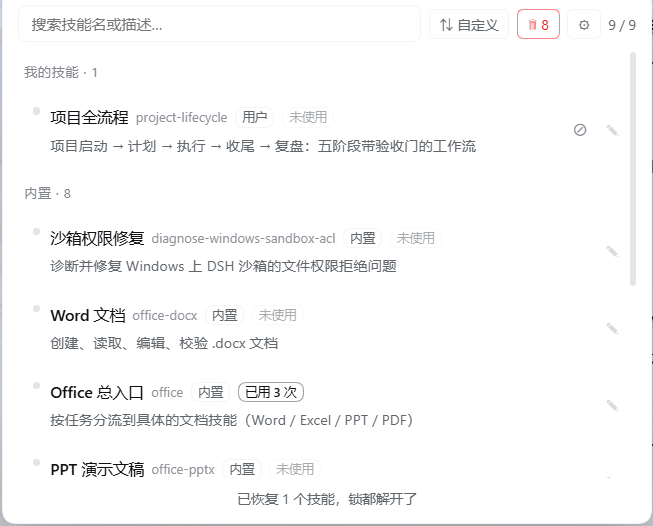

<p align="center">
  
</p>

# dsh-skill-quickpick

[English](README.en.md) | 中文

[](https://www.npmjs.com/package/@deepseek-ai/dsh)
[](LICENSE)

[](#发布状态)

给 DeepSeek Harness 输入框加一个「技能」按钮：点开按来源分组的技能面板（中文名 + 中文说明），点一项把 `/技能名 ` **插入草稿，绝不自动发送**。

技能多起来之后，你不需要再记住 30 个英文技能名 —— 搜中文就能找到它们。



> 真实界面截图（浅色主题）：按来源分组、中文名 + 英文名对照、使用次数标签、每行的禁用 / 编辑入口。

## 它能给你什么

- **中文技能名 + 中文说明**：内置对照表 + 模型自动翻译 + 你手写覆盖，三级优先级，人工调过的永远最高。翻译只发技能名和描述，不发正文。
- **一键插入，不打断思路**：点一项 → `/技能名 ` 出现在光标处，**保留你已写的草稿**，焦点自动回到输入框，接着写、回车发送。它不会替你按发送键。
- **技能再多也不乱**：按来源分组（我的技能 / 项目技能 / 内置 / 其他）、组内拖拽排序、中英混合搜索、草稿里已有 `/技能名` 的自动置灰。
- **把技能库当资产管**：禁用/启用（模型看不到但你能用）、卸载进回收站（按时自动清理）、使用统计（模型用过几次、你手动用过几次，僵尸技能一眼可见）。

## 它做什么

| 能力 | 说明 | 默认 |
|---|---|---|
| 列出技能 | 来自宿主 `skills.list`，与输入框 `/` 菜单同源 | 开 |
| **按来源分组** | 我的技能 / 项目技能 / 内置 / 其他 | 开 |
| 中文名与说明 | 内置对照 + **自动翻译** + **用户覆盖**（优先级见下） | 见开关 |
| 一键插入 | 调 `insertText`（光标处、不覆盖草稿）；失败回退 `setDraft` 追加 | 开 |
| 防重复 | 草稿里已有 `/技能名` 的条目会置灰 | 开 |
| 插入后聚焦 | 把焦点还回输入框，可直接接着写并回车发送 | 开 |
| 中英搜索 | 搜索框同时匹配中文名、中文说明、英文名、英文原文 | 开 |
| **编辑中文信息** | 中文名 / 描述 / 我的备注（备注追加显示在描述下面） | 开 |
| **拖拽排序** | 拖动行调整显示顺序，**只能同组内拖**，跨组禁止 | 开 |
| **禁用 / 启用** | 把技能从模型目录移除或加回（仅对本地技能可用） | **关** |
| **使用统计** | 模型自主加载次数 + 你手动调用次数，从没用过的标「未使用」 | **关** |
| **排序切换** | 自定义（拖拽）/ 按使用频率 / 按名称，三态循环 | 开 |
| **卸载技能** | 整个技能目录移进回收站，可随时恢复（仅本地技能，内置不可卸载） | **关** |
| **二次回收站** | 卸载的技能按保留期自动清理，**不提供手动永久删除** | **关** |

**它不做什么**：不自动发送、不调用 `submit()`、不锁定模型只能用这个技能。

## 功能开关（⚙）

面板顶部有一个齿轮按钮，可以逐项开启**高风险能力**。**默认全部关闭** —— 插件装好后只会做「列出技能、分组、搜索、插入草稿、编辑中文名/描述/备注、拖拽排序」，**不调模型、不扫会话日志、不移动技能目录**（编辑中文和拖拽排序会写插件自己的两个 JSON 文件，都在 `dsh-home` 下，不碰技能文件）。

| 开关 | 默认 | 开启后会发生什么 | 关闭后 |
|---|---|---|---|
| **禁用 / 启用技能** | 关 | 改写 `SKILL.md` 的 `disable-model-invocation` | 同一行上的 ⊘（禁用）**整个不显示**；**已禁用行的 ↺（重新启用）仍然显示且可用**，顶部「全部恢复」也照常可用 |
| **卸载 / 回收站** | 关 | 移动 `skills/` 下的技能目录；到保留期**自动永久删除** | 🗑 入口消失、卸载按钮消失、后台清理定时器不执行 |
| **自动翻译技能说明** | 关 | 把技能**名和描述**发给模型翻译（不发正文） | 只显示已缓存的译文和你手写的中文 |
| **使用统计** | 关 | 读取并解压本机历史会话日志，只计数不保存内容 | 不读会话文件、不显示使用次数 |

**为什么「启用」不跟着开关关掉**：启用是**解锁**动作，降低风险而不是增加风险。如果连解锁都禁止，用户关掉开关后就解不开已经锁上的技能了——那反而更危险。

**注意两点**：

1. **开关不是安全边界**，真正的边界是宿主侧的路径校验（见「[安全设计](#安全设计)」）。而且关闭时**宿主本身会返回 403 拒绝写请求**，不是只在界面上藏按钮。默认关的意义是「不替你承担你没同意的风险」，不是「防攻击」。
2. **开关立即生效，重新开启也立即恢复**：回收站清理定时器和统计扫描都是「总是存在、每次运行时才读开关」，所以**不需要重启**。

## 拖拽排序

```
我的技能
  ⋮ test-alpha        ← 按住拖
  ⋮ test-beta

内置
  ⋮ office-xlsx       ← 内置组也能组内排序（只是显示顺序，不碰文件）
  ⋮ office-docx
```

**规则**：
- **只能同组内拖**：跨组会被拒绝（分组是从路径推断的，跨组会让「来源」这个语义说谎）
- 拖完自动存进 `skill-quickpick-order.json`
- **搜索筛选时禁止拖拽**：拖拽排序基于完整列表，筛选态下拖动会只给筛选结果编号、其他技能顺序丢失
- 排序方式三态循环，记住你的选择（存 localStorage）

**为什么内置也能拖**：排序只是插件自己 JSON 里记「显示顺序」，完全不修改技能文件。

## 中文信息的优先级

```
你自己编辑的  >  内置对照  >  自动机翻  >  英文原文
```

三个数据层，各存各的文件，互不覆盖：

| 层 | 文件 | 谁写 | 什么时候用 |
|---|---|---|---|
| 用户编辑 | `dsh-home/skill-quickpick-user.json` | 你（面板里编辑） | 永远最高优先 |
| 内置对照 | 代码里的 `ZH` 常量 | 手工维护 | 机翻之前；人工调过的措辞不被顶掉 |
| 自动机翻 | `dsh-home/skill-quickpick-zh.json` | 自动生成 | 前两层都没有时 |

**删掉哪个文件都不会丢另一层的东西。**

### 自动翻译怎么工作

技能的英文描述写在 `SKILL.md` 的 frontmatter 里，浏览器半边读不到文件也调不了模型，所以翻译放在 **host 半边**：

```
客户端发现没有中文的技能
   ↓ POST /skill-quickpick/translate
宿主查缓存 → 缺的按降级链调模型 → 校验 → 写缓存 → 返回
   ↓ 缓存已有
直接返回（不再调模型，translated: 0）
```

**每个技能只翻一次**，之后永远读缓存。

#### 可靠性设计

**① 模型降级链**（前三条同平台，最后一条换平台兜底）

| 顺序 | provider / model |
|---|---|
| 1 | `bailian` / `glm-5.3-prime` |
| 2 | `bailian` / `kimi/kimi-k2.8-preview` |
| 3 | `bailian` / `stepfun/step-5-preview` |
| 4 | `deepseek-account` / `deepseek-flash` ← 换平台 |

某条抛错、返回非 JSON、或译文没过校验，就换下一条补。正常情况只用第一条。

**② 译文校验（零额外成本）**

| 规则 | 抓什么 |
|---|---|
| 必须含中文字符 | 模型偷懒直接回英文 |
| 中文名 ≤ 20 字 / 描述 ≤ 100 字 | 超长撑爆 UI |
| 描述不能等于英文原文 | 原样返回 |
| name 必须对得上源技能 | 模型编造名字 |
| 原文中的技术名词必须保留 | 把 Word/Excel/PPT 翻掉 |

**刻意不做「第二模型复核」**：那会让每次翻译成本翻倍，而绝大多数错误是上面这些规则错。

**③ 失败不写缓存**：全链路失败时下次自动重试，客户端退回显示英文。

## 禁用 / 启用怎么工作

禁用 = 在 `SKILL.md` 的 frontmatter 里加一行：

```yaml
disable-model-invocation: true
```

效果：

| | 禁用后 |
|---|---|
| 模型能否**自主发现并调用** | ❌ 不能（它从模型目录消失了） |
| 你在面板里还能看到吗 | ✅ 能（`userInvocable` 仍为 true） |
| 你手动 `/技能名` 还能用吗 | ✅ 能 |
| 已加载进上下文的内容 | 不受影响 |

### 哪些技能能禁用

| 技能来源 | 路径 | 能否禁用 |
|---|---|---|
| 用户技能 | `<DSH_HOME>/skills/` | ✅ 有可写的本地文件 |
| 用户 agents 技能 | `<agentsHome>/skills/`（默认 `~/.agents/skills`） | ✅ 同上 |
| **项目技能** | `<项目根>/.dsh/skills/` 或 `<项目根>/.agents/skills/` | ✅ 同上（P2 修复：以前服务端会 400） |
| **内置技能** | 打包在 `app.asar` 只读归档 | ❌ |
| 自定义目录（`customSkillDirs`） | DSH 配置项 | ❌ 见「已知限制」 |
| 运行时注册的技能 | 内存技能 | ❌ 没有文件 |

> **判定方式**：`skills/list` 只对本地文件技能回传 `path`，内置与运行时技能一律没有 `path`。所以面板用「有没有 path」判断可写性。这里的「内置（只读）」是**推断出来的分类**，实际含义是「没有可写的本地文件」。

### 项目技能怎么被认出来（P2 修复）

项目技能的根**不能问客户端要**——那等于把权限边界交给 HTTP 请求体。服务端的做法：

```
读 dsh-home/sessions/<workspace>/<session>/session.v4.jsonl.zstd
  ↓ 只解压第一帧，取 header 里的 cwd（DSH 自己写的）
cwd → 向上找最近的 .git 祖先 = 项目根（与 DSH 的 findProjectRoot 同一规则）
  ↓ 缓存 60 秒（新开的项目最迟一分钟内可用，不用重启）
<项目根>/.dsh/skills 和 <项目根>/.agents/skills 进入可信根名单
```

所以：**只有 DSH 会话记录里出现过的项目，它的项目技能才能被禁用/卸载**。没被打开过的项目，插件不会去猜它的路径。

### 禁用的安全措施

```
每次「禁用」前
├─ ① 备份 SKILL.md → dsh-home\skill-quickpick-backups\<名字>-<日期>.md
├─ ② 只改 frontmatter，正文一个字节不碰
├─ ③ 保持原文件换行风格（CRLF / LF）
├─ ④ 没有 frontmatter 的文件 → 拒绝改写并报错
└─ ⑤ 记录到 dsh-home\skill-quickpick-disabled.json
```

备份按「技能 + 日期」命名，同一天反复开关也只留一份。

**解锁永不失效**：启用方向不受「必须在可信根下」限制——项目被删、会话记录被清理之后，你仍然解得开锁。这个例外只允许删掉那行标记，不允许新建/移动任何文件。

### 一键全部恢复（停用 / 卸载插件前必做）

只要还有禁用记录，面板搜索框右边会出现一个 **`↺ N`** 按钮：

```
[搜索技能名或描述……]  [↺ 2]  [10 / 10]
                        ↑ 点它 = 解开所有锁
```

点一下会逐个恢复、验证、清空记录，浮层底部显示「已恢复 N 个技能，锁都解开了」。

**为什么必须手动点：** 插件被停用或被卸载之后就不运行了，没有任何代码能替你解锁。所以恢复动作只能发生在「插件还活着」的时候。

### 为什么不做成「停用时自动恢复」

技术上能挂 Cordis 的销毁钩子，但**重启客户端时也可能触发同一个钩子**。如果赌错了，就变成「禁用技能 → 重启 → 自动恢复」，禁用功能直接失效。所以选择明确的手动入口，而不是不可靠的自动行为。

### 想手动恢复

删掉 `SKILL.md` 里那行 `disable-model-invocation: true`，或从备份目录复制回来。

## 使用统计（谁被用过、用了几次）

面板里每个技能会带统计标签：

```
模型 3     ← 模型自己判断需要，通过 skill 工具主动加载
手动 1     ← 你输入 /技能名 显式调用
未使用     ← 两者都是 0（僵尸技能）
```

### 数据从哪来

**零 token 成本**——不调模型，只读磁盘上已有的会话日志：

```
会话日志 dsh-home/sessions/**/session.v4.jsonl.zstd
   ↓ 多帧 zstd 切分 + 逐帧解压（Node 原生 zstd 只解第一帧，要自己算帧边界）
   ↓ 按行解析 JSONL
   ├─ type=tool/call 且 data.name="skill"  → 模型自主加载（+model）
   └─ type=user/message 里的 /技能名 token  → 手动调用（+manual）
```

**统计起点**是插件安装那天的 0 点，装之前的历史不算。

### 三种被排除的情况

| 情况 | 为什么排除 |
|---|---|
| 普通文本（「测试444」） | 没有 `/技能名` token |
| URL / 路径（`http://127.0.0.1`、`/etc/passwd`） | 正则要求 `/` 前是行首或空白、后是空白或句读 |
| 系统注入（`<system-reminder>` 技能目录、`<skill_content>` 技能正文） | 否则一次 `/name` 调用会被数两遍 |

### 刷新时机

- **后台定时器**：插件启动 5 秒后扫一次，之后每 5 分钟一次（每次运行才读开关）
- 面板的 GET 请求是**纯只读**，只回报缓存，不触发扫描
- 刚发出的消息有**落盘延迟**，可能晚一次扫描才出现，这是会话日志的写入时机决定的

## 卸载与二次回收站

### 卸载怎么工作

```
点 ✎ → 「卸载」→ 输入 4 位随机数字确认
  ↓
整个技能目录 rename 到 dsh-home\skill-quickpick-trash\<时间戳>-<名字>\
  ↓
索引记在 skill-quickpick-trash.json（含原路径、删除时间）
  ↓
模型下次就看不到它了，但技能还在磁盘上
```

**硬性保护**：
- 内置技能（打包在 app.asar 里）→ 路径检查直接拒绝
- 只允许操作可信技能根下的技能（防手滑删别的东西）
- 恢复时如果原位置已有同名目录 → 拒绝，不覆盖

### 为什么不能手动永久删除

**这是刻意的设计，不是没做。**

回收站是「冷静期」：只能等保留期到期自动清理，面板里**没有永久删除按钮**。

否则「上头删掉 → 立刻清空回收站」两步就能把安全网绕没，防上头就失去意义了。

### 保留期

| 项 | 值 |
|---|---|
| 默认 | 7 天 |
| 可调范围 | **1 ~ 360 天**（最短 1 天） |
| 改法 | 回收站视图顶部「保留 [7] 天 [保存]」 |
| 清理时机 | 后台定时器：启动 15 秒后跑一次，之后每 6 小时一次（并打日志） |
| 改保留期 | **重置所有条目的计时起点**（从现在重新算），「7 天改 1 天」不会立刻删任何东西 |
| 每项显示 | 删除时间 + 「还剩 N 天」 |

### 回收站里能做什么

- **恢复**（↩）：把目录 rename 回原路径
- **看列表**：名称、删除时间、剩余天数
- **调保留期**

不能做：手动删除、改技能内容（技能已经不在技能目录里了）。

## 安装

**从插件市场装（推荐）**：DSH 桌面版打开 **Settings → Plugins**，搜 `dsh-skill-quickpick`，点安装。

**命令行装**（普通 `dsh web`）：在 profile 里加这个包，然后重启：

```sh
dsh plugin --profile <你的 profile 名> add dsh-skill-quickpick
```

**装完必须完全退出客户端再打开**（host 半边改动只有重启才生效）。

> 源码开发版（不走市场）：clone 仓库后用 DSH 插件管理器从本地路径安装，或手动放进 profile 的 `node_modules` 并登记依赖与 bundle。

## 卸载

**先解锁，再卸载**：如果还有被禁用的技能，先在面板点「↺ 全部恢复」；然后用 DSH 的插件管理卸载，或命令行 `dsh plugin remove dsh-skill-quickpick`。

源码开发版另带一个卸载脚本 `uninstall-skill-quickpick.mjs`（加 `--check` 只预览不动手），它做的事顺序很重要：

```
① 读 disabled.json，逐个把被禁用技能的锁解开（改写 + 再读一遍验证）
   ⚠️ 任何一步失败 → 立即中止并保留插件，你还能在面板点 ↺ 自救
② 从 profile 的 package.json 删掉 dependencies / bundles 两处登记
③ 删除插件目录
④ 保留数据文件（你的中文编辑、机翻缓存、备份），结尾打印路径
   加 --purge-data 才会连数据一起清
```

**为什么必须「先恢复后删除」**：插件目录一删，`disabled.json` 也跟着没了，你就再也查不到「哪些技能被锁过」，只能逐个翻 `SKILL.md`。

手动卸载仍然可行（删 package.json 两处 + 删目录），但**这样不会解锁**，被禁用的技能会永久从模型目录消失。

### ⚠️ 不要用 DSH 插件管理里的红色「卸载」按钮

那个按钮是 DSH 自己的逻辑，它只删包、不认识 `disabled.json`，**不保证解锁**。要用卸载脚本。

### 忘记恢复 / 插件已被摘掉时：独立恢复脚本

源码目录里带一个 `restore-skill-locks.mjs`，**不需要插件还装着** —— 它直接读 `dsh-home/skill-quickpick-disabled.json` 并逐个解锁：

```powershell
node restore-skill-locks.mjs --check          # 先看会改哪些文件（不动手）
node restore-skill-locks.mjs                  # 正式恢复
node restore-skill-locks.mjs --delete-record  # 恢复完顺便清掉记录文件
```

这个脚本**不依赖插件是否还装着**，是插件被摘掉之后唯一的救命通道。它同样是「改前备份 `.restore-bak` → 写回 → 再读一遍验证 → 失败项保留记录」。

## 三套工具的分工

| 场景 | 用什么 | 插件需要装吗 |
|---|---|---|
| 正常使用中想解锁 | 面板里 `↺ 全部恢复` | 需要 |
| 要卸载插件 | `uninstall-skill-quickpick.mjs` | 需要（它自己会删） |
| 忘了恢复 / 插件已被摘掉 | `restore-skill-locks.mjs` | **不需要** |

## 安全设计

**一句话**：所有写操作都限制在「DSH 自己会扫描的本地技能根」内；默认全部关闭；不主动联网。

### 权限边界

服务端不信任任何请求体里的路径。每次写操作都走同一条校验链：

| 关卡 | 拒绝什么 |
|---|---|
| ① 形状 | 非本地盘符绝对路径（UNC `\\server\share`、`\\?\` 设备前缀、相对路径） |
| ② 只读区 | `app.asar` 里打包的内置技能、`node_modules/@deepseek-ai/` |
| ③ 文件名 | basename 不是 `SKILL.md`（大小写不敏感） |
| ④ 真实路径 | `realpath` 解析符号链接 / junction，解析后仍必须是 `SKILL.md` |
| ⑤ 硬链接 | `nlink > 1` 直接拒绝（防止把外部文件硬链成 SKILL.md 再借道改写） |
| ⑥ 可信根 | 所在目录的父目录必须出现在 allowlist 里（见下表） |

**allowlist 的四级根**（与 DSH 官方文件系统 skill provider 的扫描根一致）：

| rank | 来源 | 路径 |
|---|---|---|
| 100 | 项目技能 | `<项目根>/.dsh/skills` |
| 200 | 项目 agents 技能 | `<项目根>/.agents/skills` |
| 400 | 用户技能 | `<DSH_HOME>/skills` |
| 500 | 用户 agents 技能 | `<agentsHome>/skills`（默认 `~/.agents/skills`） |

- **项目根从磁盘来**：只认 DSH 会话记录（`session.v4.jsonl.zstd` 的 header `cwd`）里出现过的项目，再按最近 `.git` 祖先求根；缓存 60 秒。
- **`DSH_HOME` 未设置时一个根都不认**（fail-safe）——不猜路径，宁可全部拒绝。
- **`customSkillDirs` 故意不认**：插件读不到 DSH 配置对象，猜路径就是「把猜测当权限」。

### 解锁方向例外

「启用 / 一键恢复」不受第 ⑥ 关约束：项目被删、会话被清理后，可信根可能已经推不出来，但用户**必须**解得开锁。这个例外只允许删掉 frontmatter 里的一行 `disable-model-invocation`，不允许新建、移动、删除任何文件。

### 数据存在哪

全部在 `dsh-home` 下，**不写技能目录以外的任何位置**：

| 文件 | 内容 |
|---|---|
| `skill-quickpick-zh.json` | 机翻缓存（可删，会重新翻） |
| `skill-quickpick-user.json` | 你手写的中文名 / 描述 / 备注（**别删**） |
| `skill-quickpick-order.json` | 拖拽排序 |
| `skill-quickpick-settings.json` | 四个开关 |
| `skill-quickpick-disabled.json` | 被禁用技能记录（解锁依据，**别删**） |
| `skill-quickpick-backups/` | 改写前的 SKILL.md 备份 |
| `skill-quickpick-trash/` + `.json` | 回收站目录与索引 |
| `skill-quickpick-stats.json` | 使用统计缓存 |

### 网络与数据外发

- 插件**自己不联网**：所有网络请求都由宿主已有的模型调用链完成。
- **只有开启「自动翻译」时才有数据外发**：发出去的内容是**技能名 + 技能描述**（`SKILL.md` frontmatter 里的两个字段），**不发正文**；开之前界面上有明确提示。
- **使用统计只读本地**：解压 `dsh-home/sessions` 下的会话日志，只计数，不保存内容、不外发。
- 面板里的 GET 接口**全部只读**：`/stats` 只回报缓存（不触发扫描），`/trash` 不触发删除（清理只由后台定时器做）。

### 开关与 403

四个开关关闭时，服务端**本身**拒绝写请求（HTTP 403），不是只在界面上藏按钮：

- `disableEnabled` 关 → `/toggle` 的禁用方向 403（启用方向放行）
- `trashEnabled` 关 → `/trash` 全部 403
- `autoTranslate` 关 → 不调模型，只返回已有缓存
- `statsEnabled` 关 → `/stats` 返回 `available: false`，不读会话日志

设置 / 排序接口拒绝空 body（`{}`、`[]`）——否则一个空 POST 就能静默关掉全部开关或清空排序。

### 回收站与时钟防护

- 回收站**没有手动永久删除**，只能等保留期到期；删前有 4 位数字确认。
- 永久删除只发生在后台定时器里，且每个路径都要过 `isInsideTrash`（realpath 校验，防止用 junction 把删除指向别处）。
- **时钟异常跳过清理**：检测到系统时间倒退、或单次跳跃超过保留期，本轮直接跳过——宁可晚删，不误删。

## 已知限制

- **停用插件不会自动解锁**：DSH 的停用操作不经过插件代码，无法拦截。面板里有黄色警告条提醒，插件重新加载时会打日志，但真正的保险是停用前先点「全部恢复」。
- **回收站不可手动清空**：设计如此（见上），只能等保留期。急也没用 😄
- **回收站清理是后台定时器**：插件启动 15 秒后跑一次，之后每 6 小时一次（不是「打开面板时才清理」），且只在「卸载/回收站」开关打开时执行。GET `/trash` 是纯只读，不触发删除。
- **时钟异常会跳过清理**：检测到系统时间倒退、或单次跳跃超过保留期时，本轮直接跳过——宁可晚删，不误删。
- **项目技能要求「会话记录里出现过这个项目」**：项目根是从 `session.v4.jsonl.zstd` 的 `cwd` 推出来的。如果项目从来没被 DSH 打开过（或会话记录被清理了），它的项目技能只能看、不能禁用/卸载。
- **`customSkillDirs` 配的技能只能看**：DSH 配置里的自定义技能目录，插件拿不到配置对象，因此不放进可信根——能插入，但不显示禁用/卸载按钮。
- **扁平技能文件（`<root>/<name>.md`）不能禁用/卸载**：DSH 支持这种形态，但插件的写操作为安全起见只认目录形态 `<root>/<名字>/SKILL.md`。面板里能看、能插入。
- **统计有落盘延迟**：最新一条消息可能要等会话日志写入后才被算进去。
- **统计依赖 Node 的 zstd**：当前 Electron（43.3）自带，若将来版本移除该 API，统计会自动降级为不可用（面板不显示标签，主功能不受影响）。
- **来源分组是启发式的**：`skills/list` 不给 `provider` 字段，只能靠 `path` 推断。空 path 一律归「内置（只读）」。
- **翻译依赖模型额度**：四条路由都不可用时新技能会一直显示英文（不影响使用）。
- **语义偏差无自动复核**：只做规则校验，译得是否贴切需要人扫一眼。
- **内置技能永远不能禁用 / 卸载**：这是 DSH 的只读打包决定的，不是插件限制。
- **`sortMode` 存在 localStorage**：Web GUI 换端口等于换 origin，排序方式会丢（拖拽顺序不受影响，它存在 dsh-home 里）。

## 技术要点（改代码前必读）

```js
// 插入必须同一轮拿锚点，失败回退追加
inserted = actions.insertText('/name ', actions.captureInsertion()) === true
if (!inserted) actions.setDraft(原草稿 + '\n' + '/name ')

// 草稿只能从 useInput 实时读，props.input.draft 永远 undefined
const inputState = useInput((s) => s)
const draft = inputState && inputState.draft

// 插入后焦点掉到 body，要还回去
document.querySelector('[data-composer-card] [contenteditable="true"]')?.focus()

// 模型流的分片：{ type: 'text-delta', text }，终止是 { kind: 'error'|'aborted', failure }

// 技能摘要：只有本地文件技能带 path，内置/运行时技能没有
// { name, description, modelInvocable, path? }

// 项目技能根：session.v4.jsonl.zstd 第一帧 header 的 cwd → 最近 .git 祖先
// { type: 'session', version: 4, id, cwd, ... }   // 只解第一帧就够，别读整个文件

// 服务端权限边界只有一个入口：resolveSkillFile(path, { allowUnlock })
// allowUnlock 只给「启用/一键恢复」用，且只允许删标记行
```

## 测试

```powershell
node test-isolated.mjs
```

**62 条，全部通过**。测试全程在系统临时目录里跑，不碰真实 dsh-home：

- 权限边界：路径穿越、UNC、设备前缀、非 SKILL.md、硬链接、app.asar
- 项目技能根：会话 header → cwd → 项目根、去重、没被打开过的项目拒绝、UNC cwd 忽略
- 解锁例外：允许越权解锁、但仍拒绝 UNC / 非 SKILL.md / 硬链接
- 回收站计时：起点取较晚者、改保留期重置计时、时钟跳跃/倒退跳过、边界值
- HTTP 层：8 条路由注册、405、Content-Type 校验、四个开关的 403 / available:false、空 body 拒绝、项目技能禁用→恢复端到端
- BOM 兼容：带 UTF-8 BOM 的 SKILL.md 能禁用/启用，且 BOM 不被删掉

## 发布状态

v0.1.0。已向 [awesome-dsh-plugin](https://github.com/awesome-dsh-plugin/awesome-dsh-plugin) 提交收录 PR（审核中）。

npm 暂未发布 —— 不影响收录与安装，插件从 GitHub 源码安装。

## License

[MIT](LICENSE)
